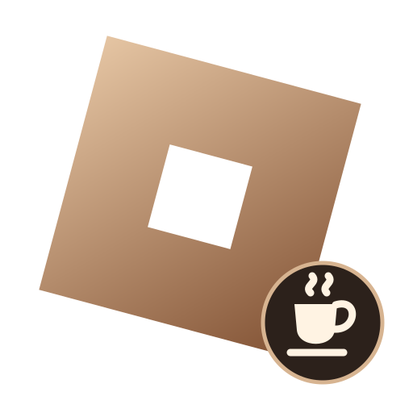
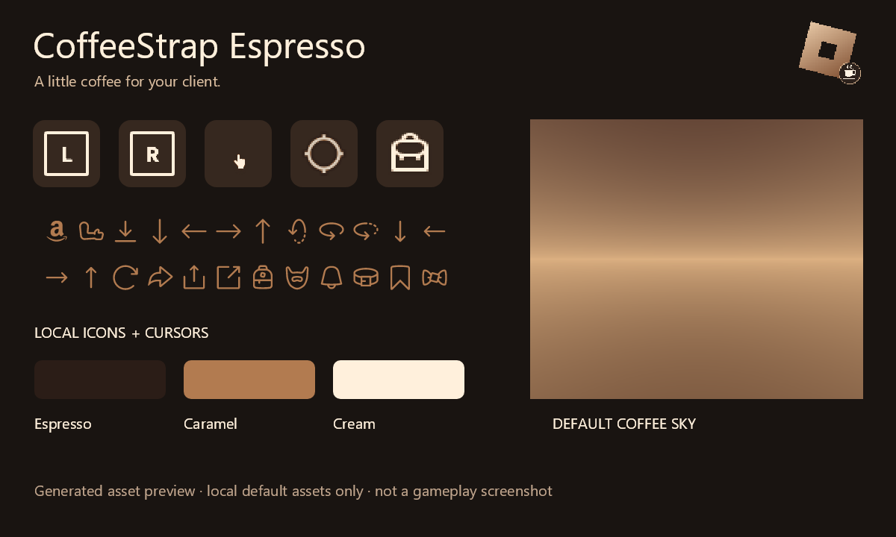

  

  
  

# CoffeeStrap

This is my fork of [Froststrap](https://github.com/Froststrap/Froststrap), built on the work of [Fishstrap](https://github.com/fishstrap/fishstrap) and [Bloxstrap](https://github.com/bloxstraplabs/bloxstrap). These launchers apply tweaks and modifications to the Roblox client through FastFlags, file mods and quality of life improvements. I didn't like some of the features and wanted more performance options, so I decided to make CoffeeStrap!

I wanted something that feels like its own app, with an espresso and cream theme, useful Game Tweaks and more control over how Roblox looks. Anyone is welcome to [join the Discord](https://discord.gg/CZ3P4Rw9D4) for questions, suggestions or info about CoffeeStrap.

## A little coffee for Roblox

My **CoffeeStrap Espresso** mod is in **Texture Editor > Community Mods**. It gives local icons, menus, cursors, the default sky and particle colors a coffee theme, including the icon fonts used by newer Roblox menus. Download it there, save, then relaunch Roblox through CoffeeStrap. You can disable it or uninstall it with the trash icon; the launcher restores its backed-up originals on the next launch.

This preview shows the actual generated assets, not a gameplay screenshot. Games can supply their own textures, UI colors and lighting, so a local theme can't recolor everything in every game. Other enabled mods can also take priority. The [theme guide](docs/ESPRESSO-THEME.md) explains coverage and how to rebuild the pack from source.

## What's in it?

- **Game Tweaks:** rendering profiles, mesh detail, texture and effects quality, default texture budgets and optional Windows session controls.
- **Texture Editor:** community mods, local file replacements, previews and an application report so you can see what applied or conflicted.
- **Quick launch:** search, pinned games and a compact launcher with the same coffee theme.
- **Server regions:** optional RoValra integration, a saved region choice and selection of the fullest available matching server found. Provider coverage and rate limits can affect results.
- **Your setup:** dark and light themes, responsive menus, animations and a reduced-motion option.

Performance depends on the game and your hardware. I don't want to promise an FPS boost from every toggle. Some changes need a Roblox restart; the live window-size controls say when they can apply immediately.

## Downloads

Grab **CoffeeStrap.exe** from the [latest GitHub release](https://github.com/EDest100/CoffeeStrap/releases/latest). The current build is for **Windows x64** and needs the **[.NET 10 x64 runtime](https://dotnet.microsoft.com/en-us/download/dotnet/10.0/runtime)** installed. The app is one EXE; .NET is separate to keep the download smaller. You don't need the source code or the Espresso ZIP just to run the launcher.

I changed the packaging to get the EXE down to **about 13.4 MB**, without cutting the UI, translations, renderers or tweaks. Everything the app needs is compressed inside that EXE. On startup it checks and unpacks its libraries into `%LOCALAPPDATA%\CoffeeStrap\RuntimeCache`, then runs in the same process. There are no DLLs to keep beside the download and no app libraries to download separately. The extracted files still total about 47.8 MB; Windows compresses that cache where supported. Settings and mods stay separate. You can clear the runtime cache while CoffeeStrap is closed, and it will rebuild on the next launch. More details are in the [packaging guide](docs/PORTABLE-PACKAGING.md).

## More Info

I used AI while making CoffeeStrap to help remove features I thought were bloated, work on the UI and add more useful tweaks. The tweaks don't read or edit Roblox's process memory, inject code or shaders, patch game binaries, or bypass the FastFlag allowlist. They use supported flags, saved settings, local content replacements and optional Windows controls. That doesn't mean every feature will work in every game or on every GPU.

CoffeeStrap is a community project and isn't affiliated with Roblox. Thanks to Froststrap, Fishstrap, Bloxstrap and everyone whose work made this possible. The original licenses and credits are kept with the source.

Want to build it yourself? Start with [BUILDING.md](docs/BUILDING.md). The source is available under [MPL-2.0](LICENSE); third-party notices are in [LICENSES](LICENSES). Older implementation and verification notes are kept in [the development history](docs/DEVELOPMENT-HISTORY.md).
